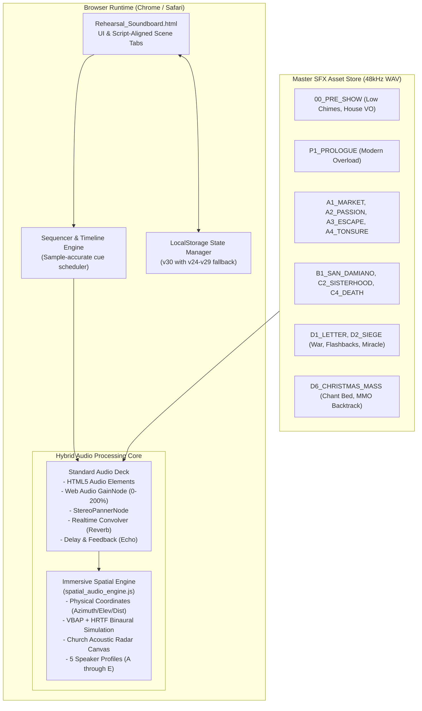

# Theatrical Audio & Spatial Soundboard Console (Play Sound Management Platform)

> **Application:** Theatrical Audio & Spatial Soundboard Console  
> **Sample Production Included:** *To Gaze: Saint Clare of Assisi*  
> **System Codename:** `TO-GAZE-SPATIAL-AUDIO-V1`  
> **Current Version:** `v30` (LocalStorage Sequencer Engine `to_gaze_soundboard_sequencer_v30`)  
> **Gary OS Project Identity:** `MEDIA-THEATRE-SOUND-MANAGEMENT` (Show ID: `MEDIA-TO-GAZE-SPATIAL-AUDIO`)  
> **Workspace Directory:** `clarw_lighting` (private Google Drive archive)  
> **Design Scope:** Modular sound management, cue automation, and 3D spatial audio for stage plays  

---

## 1. Executive Summary

This repository provides a modular, zero-dependency Web Audio soundboard, timeline cue automator, and immersive 3D acoustic spatial playback system engineered specifically for live theatre and stage play sound design.

The included reference production is ***To Gaze: Saint Clare of Assisi***, demonstrating end-to-end multi-scene sound cues, continuous audio beds, vocal proximity filtering, and acoustic radar mapping. The underlying architecture and control interface are designed as a reusable production platform for any stage play or live performance.

The primary operational dashboard is [`Rehearsal_Soundboard.html`](./Rehearsal_Soundboard.html), a zero-dependency, standalone Web Audio and HTML5 single-page application engineered to run entirely offline from a local browser (Chrome or Safari) without requiring web servers, node runtimes, or database backends.

The system handles both standard stage soundboard playback (independent cue triggers, automated scene timelines, continuous looping beds, volume faders with +6dB headroom, real-time reverb/echo DSP) and real-time church-scale **3D spatial audio panning** across 5 hardware-adaptive speaker configurations (from stereo/binaural up to 8-channel perimeter and sanctuary dome height arrays).

---

## 2. Adapting for Other Stage Plays

To deploy this platform for a new theatrical production or live show:
1. **Define Scene & Cue Data:** Update `SCENES_DATA` in [`Rehearsal_Soundboard.html`](./Rehearsal_Soundboard.html) or export/import custom scene presets with your play's acts, scenes, and audio cue identifiers.
2. **Acoustic Radar & Spatial Coordinates:** Map your sound coordinates (azimuth, elevation, distance) in [`spatial_audio_engine.js`](./spatial_audio_engine.js) to match your physical stage dimensions and speaker rig.
3. **Asset Directory:** Place your 48 kHz stereo production WAV/MP3 files into `SFX/<SCENE_NAME>/` and run `python3 verify_assets.py` to confirm zero missing assets before curtain call.

---

## 3. Quick Start Guide

### Recovering the complete project

Clone or pull the public source repository, then restore the private `SFX/` directory from Google Drive. See [`ASSET_RESTORE.md`](./ASSET_RESTORE.md). Production audio is deliberately excluded from public GitHub because it contains large masters and recordings that are not cleared for public redistribution.

### Running the Dashboard
1. Simply double-click [`Rehearsal_Soundboard.html`](./Rehearsal_Soundboard.html) or run in terminal:
   ```bash
   open Rehearsal_Soundboard.html
   ```
2. Click anywhere on the dashboard or press the **SPACEBAR** to initialize the Web Audio Context.
3. Use the top navigation bar to jump between scenes or click **🌐 Show All Scenes**.

### Live Theatrical Controls
* **Play Scene / Stop Scene:** Located in each scene header. Executes the automated rehearsal cue sequence with sample-accurate cue timings.
* **Volume Faders (`0%` – `200%`):** Nominal unity gain is `100%`. Faders can be boosted up to `200%` (+6dB gain headroom) for quiet cues.
* **Pan Sliders (`L100%` – `R100%`):** Real-time stereo panner for physical left/right speaker steering.
* **FX Texture Bars (Reverb & Echo):** Real-time convolution reverb (Cathedral / Stone Hall) and feedback delay echo per track.
* **Option Dropdowns:** Instant switching between alternate takes and acoustic masters (e.g. Clean Voice, Cathedral Halo, Warm Proximity).
* **Save Preset:** Persists all volume adjustments, cue timings, pan positions, trim boundaries, and active take selections to `localStorage`.
* **Export / Import Preset:** Download or load portable production JSON state files for backup across stage computers.

---

## 3. System Architecture & Audio Flow



---

## 4. Scene & Cue Manifest

The dashboard is structured into **11 script-aligned tabs** reflecting the exact theatrical structure:

| Scene Tab | Scene Name | Key Sound Cues | Notable Automation / DSP Features |
| :--- | :--- | :--- | :--- |
| **`[Pre-Show]`** | House Announcement | `[SFX-PRE-01]` Pre-Show Low Chimes<br/>`[SFX-PRE-02]` House Announcement | Automated sequence: Low Chimes (0.0s) toll and decay into Warm House VO (8.0s). De-noised from car recording (+43.6dB SNR). |
| **`[Act 0, Sc 1]`** | Christ on the Cross | `SFX-01A` Clare's Breath<br/>`SFX-01` TV On<br/>`SFX-02` Mouse Clicks<br/>`SFX-02B` Instagram<br/>`SFX-02C` Tinder<br/>`SFX-03` Traffic<br/>`SFX-04A` News<br/>`SFX-04B` Siren<br/>`SFX-04C` Climate<br/>`SFX-05` Ambulance<br/>`SFX-06` Commercials<br/>`SFX-07` Glitch<br/>`SFX-06B` Historical Bleed<br/>`SFX-08` Hard Cut<br/>`SFX-09` Hum | Modern sensory overload wall-of-sound ending on abrupt hard cut silence. Continuous bed looping with adjustable loop points. |
| **`[Act I, Sc 2]`** | The Meeting of Francis | `SFX-10A` Palm Sunday Street Gathering | Palm Sunday Assisi bells, medieval crowds, and sacred Latin liturgical chants. |
| **`[Act I, Sc 3]`** | The Escape | `SFX-35` Lightning Strike<br/>`SFX-36` Voice of God<br/>`SFX-14` Door of the Dead | Dramatic thunderstorm with cathedral lightning shock, divine transformation voice, and heavy oak door pounding. |
| **`[Act II, Sc 4]`** | San Damiano | `SFX-15` Stone Masonry<br/>`SFX-34` Digital Glitch Transition<br/>`SFX-16_WATER` Stream Water | Intimate natural convent acoustics: running cloister spring water and physical chisel strikes. |
| **`[Act II, Sc 5]`** | Sisterhood & Passing | `SFX-17_CANTICLE` Canticle of the Sun | Acoustic monastic canticle with sacred vocal drone and ambient bell resonance. |
| **`[Act III, Sc 6]`** | Letters to Prague | `SFX-23` Parchment & Quill<br/>`SFX-37` Agnes of Prague VO | Tactile 13th-century writing textures and spatialized letter recital voice-over. |
| **`[Act III, Sc 7]`** | The Siege | `SFX-D2_DRUMS` War Drums<br/>`SFX-D2_WAR` War Soundscape<br/>`SFX-D2_GATE` Oak Gate Slam<br/>`SFX-D2_FB1` Flashback 1 (Father)<br/>`SFX-D2_FB2` Flashback 2 (Clare)<br/>`SFX-D2_VO` Sister's Warning | Dynamic acoustic siege states: External war, Auditory isolation tunnel, and Convent gate defense. |
| **`[Act III, Sc 7-2]`** | Eucharistic Miracle | `SFX-26` Divine Warp Shockwave<br/>`SFX-CHILD_GOD` Voice of Christ as Child<br/>`SFX-33A_D2` Canonical Heartbeat | Continuous heartbeat loop with draggable `♾️` seeker at 18.0s. Shockwave and child voice fire once while prayer pulse persists. |
| **`[Act IV, Sc 8]`** | The Christmas Vision | `SFX-38` Christmas Mass Liturgy Bed<br/>`SFX-23_PAPAL` Papal Seal Cue | 15-minute sacred mass bed with dedicated **⏳ SLOW CROSSFADE OUT (30s)** button, live animated contracting gradient meter, and fader tracking. |
| **`[Act IV, Sc 9]`** | Final Gaze & Blackout | `SFX-39` The Story of St Clare MMO | Full orchestral backing track (Backtrack MMO in 24-bit studio quality and universal master). |

---

## 5. Key System Capabilities

### 5.1 Slow Crossfade Out System with Real-Time Meter
For `[SFX-38]` Christmas Mass in Act IV:
* Dedicated purple control bar with customizable fade duration (default `30s`).
* Volume smoothly decreases across 750 micro-steps (25fps resolution) with zero zipper noise.
* Real-time **Live Visual Fade Off** meter contracts from 100% to 0% with countdown (`38% (11.4s left)`).
* Physical volume fader slides down in real-time, cleanly stopping at zero and resetting back to default level for the next run.

### 5.2 Voice of Christ as a Child (`SFX-CHILD_GOD`)
* Re-engineered using Rubber Band R3 (`-3 -F --centre-focus`) at tempo `0.68` (4.8s duration) with **zero pitch drop** (`pitch=1.0`), maintaining pure childlike innocence and crystal-clear speech.
* Formant-preserving slow down creates an unhurried, calm, mysterious delivery.
* Wrapped in a celestial cathedral acoustic halo (RT60 ~3.2s) with optional sacred 65 Hz sub-glow (-15 dB).

### 5.3 Immersive Spatial Audio Engine (`spatial_audio_engine.js`)
* Maps every sound cue to 3D spherical coordinates (azimuth, elevation, distance, occlusion).
* Interactive 2D Church Acoustic Radar canvas shows live audio positions relative to the Altar, Clare, and the Audience.
* Supports 5 speaker profiles:
  * **Profile A:** Stereo / Binaural 3D (Default rehearsal mode using HRTF simulation).
  * **Profile B:** Quad Surround (4-corner nave).
  * **Profile C:** 5.1 Theatrical Surround.
  * **Profile D:** 7.1 Perimeter Wrap.
  * **Profile E:** Church Height Array (dome ceiling height speakers).

### 5.4 Non-Destructive State Persistence
* `STORAGE_KEY` is currently set to `to_gaze_soundboard_sequencer_v30`.
* Backward-compatible fallback chain automatically migrates state from `v29`, `v28`, `v27`, `v26`, `v25`, and `v24` without overwriting custom operator cue timings, trim boundaries, or volume balances.

---

## 6. Directory Layout

```
clarw_lighting/
├── Rehearsal_Soundboard.html     # Primary theatrical playback dashboard & Web Audio app
├── spatial_audio_engine.js       # Modular 3D spatial audio & multichannel routing engine
├── SFX_Master_Production_Cue_Sheet.csv # Master CSV cue sheet for SM & Sound Designer
├── README.md                     # This documentation
├── .gitignore                    # Git ignore file for repo initialization
│
├── SFX/                          # Master 48kHz audio repository (1.4 GB total)
│   ├── 00_PRE_SHOW/              # Pre-show low chimes & restored house announcement
│   ├── 00_GLOBAL/                # Universal cues (canonical heartbeats)
│   ├── P1_PROLOGUE/              # Prologue modern media soundscape
│   ├── A1_MARKET/                # Assisi marketplace atmospheres
│   ├── A2_THE_PASSION/           # Passion & Palm Sunday street gathering
│   ├── A3_ESCAPE/                # Night escape soundscapes
│   ├── A4_TONSURE/               # Tonsure cutting shears & sacred bells
│   ├── B1_SAN_DAMIANO/           # Stone masonry, cicadas, running water
│   ├── C2_SISTERHOOD/            # Canticle of the Sun and convent beds
│   ├── D1_LETTER/                # Parchment, quill, Agnes of Prague VO
│   ├── D2_SIEGE/                 # War drums, gate slams, flashbacks, child voice
│   ├── D6_CHRISTMAS_MASS/        # 15m Christmas Mass bed & MMO backtrack
│   └── BACKUPS/                  # Safety audio archives
│
├── scripts/                      # Maintenance and DSP build scripts
│   ├── build_clean_d2_siege.py
│   ├── build_d2_youtube_war.py
│   ├── integrate_immersive_spatial_engine.py
│   ├── update_soundboard_html.py
│   └── update_soundboard_to_9_tabs.py
│
└── scratch/                      # Temporary build logs and experiment scripts (ignored by git)
```

---

## 7. Developer & Gary OS Integration Notes

### Git repository
The public source repository is:

`https://github.com/glfernandez/to-gaze-spatial-audio`

To recover or update the source:
```bash
git clone https://github.com/glfernandez/to-gaze-spatial-audio.git
cd to-gaze-spatial-audio
# Restore the private SFX directory using ASSET_RESTORE.md.
```

The full archive remains in the private Google Drive folder `My Drive/clarw_lighting`. See [`GARY_OS_PROJECT.md`](./GARY_OS_PROJECT.md) for the Gary OS identity and recovery contract, and [`SECURITY.md`](./SECURITY.md) for the publication boundary.

### Health & Syntax Verification
To verify the HTML and JavaScript syntax before deploying:
```bash
# Verify JavaScript embedded in Rehearsal_Soundboard.html
python3 -c "
import re, subprocess
with open('Rehearsal_Soundboard.html', 'r', encoding='utf-8') as f:
    scripts = re.findall(r'<script.*?>([\s\S]*?)</script>', f.read(), re.IGNORECASE)
for idx, code in enumerate(scripts):
    if code.strip():
        res = subprocess.run(['node', '--check'], input=code, text=True, capture_output=True)
        if res.returncode != 0:
            print(f'Syntax error in script {idx}:', res.stderr)
            exit(1)
print('All scripts validated cleanly!')
"
```

### Asset Integrity Check
All referenced audio files in `Rehearsal_Soundboard.html` are confirmed present on disk in the `SFX/` tree with 0 missing files. All audio files are formatted as 48.0 kHz 16-bit or 24-bit uncompressed PCM stereo WAV.

---

## 8. Handover Contact & Production Credits
* **Production:** *To Gaze: Saint Clare of Assisi*
* **Sound Design & Engineering:** Gemini Advanced Agentic Coding Pair-Programming System
* **Lead Producer / Technical Director:** Gary Fernandez
