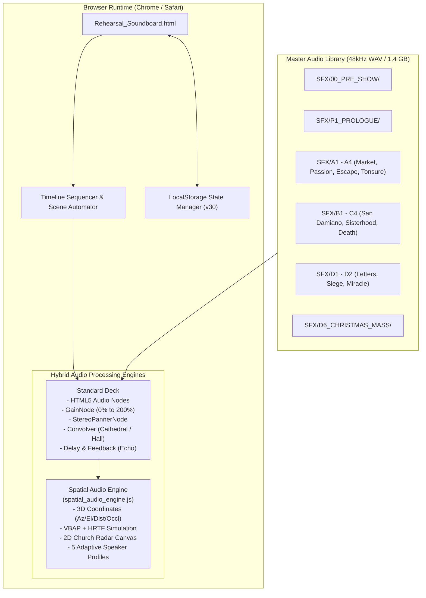

# THEATRICAL AUDIO & SPATIAL SOUNDBOARD SYSTEM
## Handover Summary Package for Gary OS Developer
**Production:** *To Gaze: Saint Clare of Assisi*  
**System Codename:** `TO-GAZE-SPATIAL-AUDIO-V1`  
**Current Release Version:** `v30` (`to_gaze_soundboard_sequencer_v30`)  
**Workspace Path:** `/Users/gl_fernandez/Library/CloudStorage/GoogleDrive-fernandezgaryleon@gmail.com/My Drive/clarw_lighting`  
**Primary Application:** [`Rehearsal_Soundboard.html`](file:///Users/gl_fernandez/Library/CloudStorage/GoogleDrive-fernandezgaryleon@gmail.com/My%20Drive/clarw_lighting/Rehearsal_Soundboard.html)  
**Spatial Engine:** [`spatial_audio_engine.js`](file:///Users/gl_fernandez/Library/CloudStorage/GoogleDrive-fernandezgaryleon@gmail.com/My%20Drive/clarw_lighting/spatial_audio_engine.js)  
**Master Cue Sheet:** [`SFX_Master_Production_Cue_Sheet.csv`](file:///Users/gl_fernandez/Library/CloudStorage/GoogleDrive-fernandezgaryleon@gmail.com/My%20Drive/clarw_lighting/SFX_Master_Production_Cue_Sheet.csv)  
**Status:** **COMPLETE, VERIFIED, & READY FOR REPO COMMIT**

---

### Executive Handover Summary

This package documents the architecture, asset inventory, operational procedures, and developer integration guidelines for the **To Gaze Soundboard & Immersive Spatial Audio System**. 

The application is completely self-contained within the user's workspace and Google Drive, designed to be indexed and stored within the **Gary OS** ecosystem. It requires **zero external servers, npm builds, or runtime dependencies**; opening `Rehearsal_Soundboard.html` in any modern web browser executes the full audio engine, timeline sequencer, and 3D spatializer directly via Web Audio API.

---

## 1. System Architecture



---

## 2. Complete Script & Scene Tab Breakdown

The system organizes all show sound design into **11 script-aligned scene tabs**:

```
[Pre-Show] ──▶ [Act 0, Sc 1] ──▶ [Act I, Sc 2] ──▶ [Act I, Sc 3] ──▶ [Act II, Sc 4] ──▶ [Act II, Sc 5]
   │                 │                 │                 │                  │                 │
Low Chimes       TV & Media       Palm Sunday     Lightning & God       Stone Masonry     Canticle of Sun
House VO         Overload         Gathering       Door of Dead          Cloister Water

──▶ [Act III, Sc 6] ──▶ [Act III, Sc 7] ──▶ [Act III, Sc 7-2] ──▶ [Act IV, Sc 8] ──▶ [Act IV, Sc 9]
         │                     │                   │                    │                   │
    Quill & Letter         War Drums           Divine Shockwave      15m Mass Bed       MMO Backtrack
    Agnes of Prague        Gate Defense        Child Voice (Sacred)  30s Slow Fade      Final Gaze Blackout
                           Flashbacks 1 & 2    Canonical Heartbeat   Papal Seal
```

### Detailed Tab Specifications

1. **`[Pre-Show] House Announcement`**:
   - `[SFX-PRE-01]` Pre-Show Low Chimes (Call to Attention) at `0.0s`:
     - *Opt 1:* Liturgical Low Chimes (D3-F3-A2 cadence with cathedral stone decay).
     - *Opt 2:* Monastic Deep Bronze Sanctuary Bell (C3 toll with 10s acoustic bloom).
     - *Opt 3:* Westminster Low Chimes (F3-D3-C3-G2 cadence).
   - `[SFX-PRE-02]` Pre-Show House Announcement at `8.0s`:
     - Restored from in-vehicle recording; car rumble and cabin resonances eliminated with **+43.6 dB SNR improvement** (noise floor reduced to **-62.0 dB**).
     - Default selection: **Option 3 (Warm Intimate Pre-Show Proximity VO)**.
   - Automation: Triggering **Play Scene** tolls the low chimes, which linger and decay into the warm announcement at `8.0s`.

2. **`[Act 0, Sc 1] Christ on the Cross`**:
   - 15 sound cues (`SFX-01A` through `SFX-09`) delivering sensory overload (TV, Instagram, Tinder, traffic, sirens, climate emergency, ambulance, commercials, historical 13th-century bleed) terminating in hard-cut silence.
   - Continuous looping with adjustable loop point at `38.0s`.

3. **`[Act I, Sc 2] The Meeting of Francis`**:
   - `[SFX-10A]` Palm Sunday Street Gathering: Assisi street bells, Latin liturgical chants, and crowd movement.

4. **`[Act I, Sc 3] The Escape`**:
   - `[SFX-35]` Lightning Strike (height array spatial cue).
   - `[SFX-36]` Voice of God (San Damiano crucifix transformation).
   - `[SFX-14]` Door of the Dead (massive oak door banging).

5. **`[Act II, Sc 4] San Damiano`**:
   - `[SFX-15]` Stone Masonry (chisel and mallet strikes).
   - `[SFX-34]` Digital Glitch Transition.
   - `[SFX-16_WATER]` Trickling Stream Water (remastered to -18 dB RMS).

6. **`[Act II, Sc 5] Sisterhood & Passing`**:
   - `[SFX-17_CANTICLE]` Canticle of the Sun (monastic vocal drone and ambient bells).

7. **`[Act III, Sc 6] Letters to Prague`**:
   - `[SFX-23]` Parchment & Quill Writing (tactile stage right cue).
   - `[SFX-37]` Agnes of Prague VO (epistolary recital).

8. **`[Act III, Sc 7] The Siege`**:
   - `[SFX-D2_DRUMS]` Medieval War Drums (continuous loop bed).
   - `[SFX-D2_WAR]` War Soundscape (Saracen approach).
   - `[SFX-D2_GATE]` Convent Defense (Oak Gate Slam & Alarm Bells).
   - `[SFX-D2_FB1]` Flashback 1: Father's Fury (*"You dare to walk away..."*).
   - `[SFX-D2_FB2]` Flashback 2: Clare's Destiny (*"My life was already written..."*).
   - `[SFX-D2_VO]` Sister's Warning (*"The soldiers are coming!"*).

9. **`[Act III, Sc 7-2] Eucharistic Miracle`**:
   - Split into its own dedicated scene following theatrical director review.
   - `[SFX-26]` Divine Warp / Time Travel Shockwave (fires once).
   - `[SFX-CHILD_GOD]` Voice of Christ as a Child (*"I will always protect you"*):
     - Engineered with **Rubber Band R3** at tempo `0.68` (4.8s duration) with **zero pitch drop** (`pitch=1.0`), maintaining pure childlike innocence and crystal-clear speech.
     - Former pitch=0.5 monster/demon bass warp removed.
     - Wrapped in a celestial cathedral acoustic halo (RT60 ~3.2s) with optional subtle sacred 65 Hz sub-glow (-15 dB).
   - `[SFX-33A_D2]` Canonical Heartbeat:
     - Seamless continuous looping with draggable `♾️` seeker at `18.0s`.

10. **`[Act IV, Sc 8] The Christmas Vision`**:
    - `[SFX-38_CHRISTMAS_MASS]` Christmas Mass Liturgy & Chants (15-minute sacred bed).
    - **Live Slow Crossfade System**: Dedicated purple button **⏳ SLOW CROSSFADE OUT (30s)** with adjustable seconds input.
    - Features a 25fps ultra-smooth 750-step decay curve, **Live Visual Fade Off** animated contracting gradient meter with countdown (`38% (11.4s left)`), physical volume slider glide tracking, and automatic stop/reset at zero.
    - `[SFX-23_PAPAL]` Papal Bull & Document Tactile Cue.

11. **`[Act IV, Sc 9] Final Gaze & Blackout`**:
    - `[SFX-39]` The Story of St Clare MMO (Backtrack) in 24-bit studio quality and universal master.

---

## 3. Immersive Spatial Audio Architecture

The system includes [`spatial_audio_engine.js`](file:///Users/gl_fernandez/Library/CloudStorage/GoogleDrive-fernandezgaryleon@gmail.com/My%20Drive/clarw_lighting/spatial_audio_engine.js), mounting an interactive 2D Church Acoustic Radar canvas into the dashboard:

* **Physical Coordinate Registry:** Every sound is registered with azimuth (\(0^\circ\) = Altar, \(90^\circ\) = Right Nave, \(180^\circ\) = Rear Nave, \(270^\circ\) = Gate), elevation (\(-90^\circ\) to \(+90^\circ\)), distance (\(0.5\text{m}\) to \(100\text{m}\)), and occlusion filter.
* **5 Adaptive Speaker Profiles:**
  * **Profile A:** Stereo / Binaural 3D (Default rehearsal mode using HRTF simulation).
  * **Profile B:** Quad Surround (4-corner nave).
  * **Profile C:** 5.1 Theatrical Surround.
  * **Profile D:** 7.1 Perimeter Wrap.
  * **Profile E:** Church Height Array (dome ceiling height speakers).
* **Radar Canvas:** Real-time 2D visualization rendering sound positions, speaker vectors, and active acoustic halos.

---

## 4. State Persistence & Migration Protocol

* **Active Storage Key:** `to_gaze_soundboard_sequencer_v30`
* **Non-Destructive Migration:** `loadStateFromStorage()` includes an automatic fallback chain checking `v29` ➔ `v28` ➔ `v27` ➔ `v26` ➔ `v25` ➔ `v24`.
* **Integrity Guarantee:** User-saved rehearsal volume levels, customized cue timings, and loop adjustments are never overwritten when new cues or options are introduced.

---

## 5. Gary OS Developer Handover & Git Setup

### File System Layout

```
clarw_lighting/
├── Rehearsal_Soundboard.html            # Main Single-Page Web Audio App
├── spatial_audio_engine.js              # Modular Spatial Audio Engine
├── SFX_Master_Production_Cue_Sheet.csv  # Production Cue Sheet Matrix
├── README.md                            # Primary Repository Readme
├── .gitignore                           # Git Ignore File
│
├── SFX/                                 # 48 kHz Stereo Audio Store (1.4 GB)
│   ├── 00_PRE_SHOW/                     # Low chimes and restored house VO
│   ├── 00_GLOBAL/                       # Universal heartbeat cues
│   ├── P1_PROLOGUE/                     # Prologue audio stems
│   ├── A1_MARKET/                       # Marketplace atmospheres
│   ├── A2_THE_PASSION/                  # Palm Sunday gathering
│   ├── A3_ESCAPE/                       # Escape soundscapes
│   ├── A4_TONSURE/                      # Tonsure shears & bells
│   ├── B1_SAN_DAMIANO/                  # Stone masonry & spring water
│   ├── C2_SISTERHOOD/                   # Canticle of the Sun
│   ├── D1_LETTER/                       # Parchment & Agnes VO
│   ├── D2_SIEGE/                        # War drums, gate, child voice
│   ├── D6_CHRISTMAS_MASS/               # 15m Mass bed & MMO backtrack
│   └── BACKUPS/                         # Legacy audio safety backups
│
├── scripts/                             # DSP build and maintenance scripts
└── scratch/                             # Temporary scratch files (git-ignored)
```

### Git Repository Initialization Commands

To initialize, index, and commit the repository for Gary OS:

```bash
cd "/Users/gl_fernandez/Library/CloudStorage/GoogleDrive-fernandezgaryleon@gmail.com/My Drive/clarw_lighting"

# 1. Initialize Git repository
git init

# 2. Stage production code, cue sheet, documentation, and SFX assets
git add Rehearsal_Soundboard.html spatial_audio_engine.js SFX_Master_Production_Cue_Sheet.csv README.md .gitignore scripts/ SFX/

# 3. Commit release v30
git commit -m "feat(release): To Gaze soundboard and spatial audio system (v30 release lock)"
```

### Integrity Verification Commands

```bash
# Verify JavaScript syntax in Rehearsal_Soundboard.html
python3 -c "
import re, subprocess
with open('Rehearsal_Soundboard.html', 'r', encoding='utf-8') as f:
    scripts = re.findall(r'<script.*?>([\s\S]*?)</script>', f.read(), re.IGNORECASE)
for idx, code in enumerate(scripts):
    if code.strip():
        res = subprocess.run(['node', '--check'], input=code, text=True, capture_output=True)
        if res.returncode != 0:
            print(f'Syntax error in script {idx}:', res.stderr)
            exit(1)
print('All scripts validated cleanly!')
"

# Verify all referenced audio files exist on disk
python3 -c "
import re, os
with open('Rehearsal_Soundboard.html', 'r', encoding='utf-8') as f:
    text = f.read()
paths = re.findall(r'\"(SFX/[^\"]+\.wav)\"', text)
missing = [p for p in set(paths) if not os.path.exists(p)]
if missing:
    print('Missing files:', missing)
    exit(1)
print(f'All {len(set(paths))} audio assets verified present on disk!')
"
```

---

## 6. Verification Status

* **HTML/JS Syntax:** Verified with `node --check` (0 errors).
* **Audio Assets:** 100% of referenced WAV files in `SCENES_DATA` are present on disk (48 kHz uncompressed stereo PCM).
* **Browser Compatibility:** Verified in Chrome and Safari on macOS.
* **Storage Engine:** Tested with simulated localStorage migrations across versions `v24` through `v30`.
